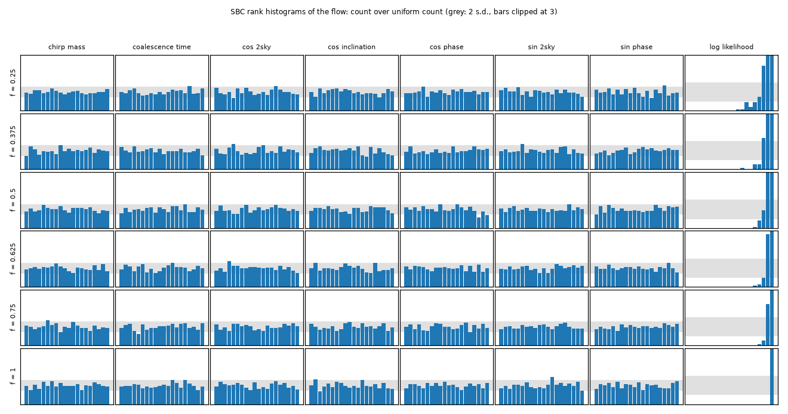
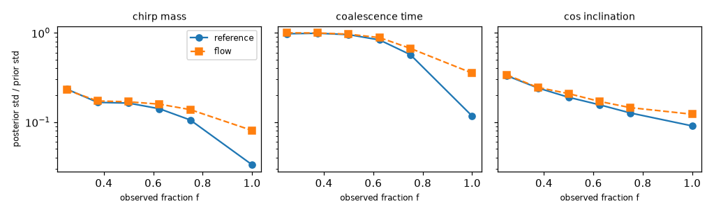

# early-chirp-posterior

How early in an inspiral can a neural posterior estimator, trained once on simulations, give a calibrated
posterior for a chirping signal, and how far is it from the exact posterior when only a fraction of the signal
has been observed?

The study uses a toy chirp seen through two channels with coloured Gaussian noise of known spectrum. The
likelihood is exact, so the true posterior can be sampled and used as the reference. The package is `chirpvi`
(PyTorch and numpy); the figure script also needs matplotlib, which the `dev` extra installs.

## Results

Two flows were trained with the same settings (seeds 0 and 1). Unless a title says seed1, the numbers below were
measured on the first one. It saw 18,500 batches of 2,048 fresh simulations (37.9 million observations, none
reused) in 23.4 minutes on a T4. The tables are the output of `scripts/report.py` (kept in `results/tables.txt`,
which also holds the seed1 tables); the figures come from `scripts/figures.py`.

In short: the flow is calibrated in its marginals at every observed fraction, and while the signal is weak it
stays close to the exact posterior (the classifier test is 0.04 to 0.07 above the reference sampler's own
floor up to f = 0.625). Once the exact posterior gets narrow (f = 0.75 and above) the flow is too wide: 2.0 and
2.5 times wider than the reference for the chirp mass and the merger time at f = 1. The marginal checks do not
show this; the rank of the exact log likelihood does. Reusing the posterior at one fraction as the proposal for
the next needs 2.0 to 3.6 times fewer likelihood evaluations than starting from the prior, and drawing 2048
samples from the flow is 39 to 190 times faster than the reference sampler on the T4 (99 times on one CPU
thread). The second flow shows the same pattern, with small departures in its marginal ranks at f = 1.

### Signal level

| f | samples | p10 | median | p90 |
|---|---|---|---|---|
| 0.25 | 64 | 2.8 | 4.3 | 6.9 |
| 0.375 | 96 | 3.7 | 5.7 | 9.1 |
| 0.5 | 128 | 4.6 | 7.0 | 11.3 |
| 0.625 | 160 | 5.5 | 8.5 | 13.7 |
| 0.75 | 192 | 6.6 | 10.2 | 16.4 |
| 1 | 256 | 9.4 | 14.9 | 24.5 |

Whitened signal to noise ratio over 20,000 prior draws (`results/snr.json`). The exact posterior is wide when a
quarter of the buffer has been seen and narrow at the end.

### Training

| steps | minutes | best validation NLL | parameters | device |
|---|---|---|---|---|
| 18500 | 23.4 | -5.174 | 2283030 | cuda |

The first attempt used the default peak learning rate 3e-4 with the same batch size and diverged: the
validation NLL was -2.98 at step 500, +2.37 at step 1000 and +54.0 at step 1500, and the log ends at step 2000
where the run was stopped (`results/train_lr3e-4_diverged.log`). The run reported here uses 1.5e-4: no step was
skipped and the best validation NLL came at the last evaluation. No other rate was run at full length.

### The reference sampler

| KS phase | KS sky | mode weight | log evidence gap | symmetry error |
|---|---|---|---|---|
| 0.022 | 0.015 | 0.493 | 0.057 | 1.3e-13 |

| f | median C2ST | max C2ST | median log evidence gap | plain vs symmetrized C2ST | plain mode gap |
|---|---|---|---|---|---|
| 0.5 | 0.552 | 0.621 | 0.220 | 0.568 | 0.020 |
| 0.75 | 0.550 | 0.574 | 0.207 | 0.567 | 0.026 |
| 1 | 0.511 | 0.572 | 0.357 | 0.509 | 0.024 |

Against the exact grid posterior of the two angles (the other parameters fixed) the sampler's marginals are
within a Kolmogorov distance of 0.022 and 0.015, its mode weight is 0.493 (exact value 0.5) and its log evidence
is 0.06 away. Two independent runs on the same data (12 injections per fraction) differ by a classifier test
accuracy of 0.55 at f = 0.5 and 0.75 and 0.51 at f = 1: close to 0.5 but not at it, which sets the floor for
what a flow can be asked to match. At this size (2048 particles, 20 moves) the sampler without the pair
symmetry move also keeps the two modes balanced (median gap 0.02 to 0.03) and differs from the symmetrized one
by 0.51 to 0.57.
The evidence estimates of two runs differ by 0.2 to 0.4, so evidences are not used anywhere else.

### Calibration of the flow



| f | chirp_mass | coalescence_time | cos_2sky | cos_inclination | cos_phase | log_likelihood | sin_2sky | sin_phase |
|---|---|---|---|---|---|---|---|---|
| 0.25 | 0.019 (0.85) | 0.036 (0.14) | 0.016 (0.96) | 0.033 (0.21) | 0.013 (0.99) | 0.753 (0.00) | 0.039 (0.09) | 0.026 (0.52) |
| 0.375 | 0.025 (0.56) | 0.027 (0.45) | 0.021 (0.74) | 0.045 (0.03) | 0.038 (0.10) | 0.821 (0.00) | 0.020 (0.81) | 0.040 (0.08) |
| 0.5 | 0.025 (0.56) | 0.028 (0.43) | 0.027 (0.43) | 0.021 (0.78) | 0.048 (0.02) | 0.846 (0.00) | 0.018 (0.90) | 0.043 (0.05) |
| 0.625 | 0.027 (0.45) | 0.024 (0.58) | 0.025 (0.55) | 0.033 (0.22) | 0.016 (0.96) | 0.872 (0.00) | 0.034 (0.20) | 0.018 (0.91) |
| 0.75 | 0.030 (0.32) | 0.034 (0.19) | 0.024 (0.61) | 0.025 (0.56) | 0.017 (0.92) | 0.895 (0.00) | 0.017 (0.94) | 0.030 (0.34) |
| 1 | 0.022 (0.71) | 0.021 (0.76) | 0.024 (0.62) | 0.026 (0.48) | 0.015 (0.97) | 0.952 (0.00) | 0.035 (0.16) | 0.020 (0.83) |

SBC: Kolmogorov distance of the ranks to uniform, with its p value in brackets. 1000 fresh simulations per
fraction, 200 posterior samples each; the log likelihood column uses the first 300 of them.

| f | 0.5 | 0.68 | 0.9 | 0.95 |
|---|---|---|---|---|
| 0.25 | 0.003 | 0.012 | -0.009 | -0.008 |
| 0.375 | 0.020 | 0.022 | 0.002 | -0.005 |
| 0.5 | 0.021 | 0.025 | 0.001 | 0.002 |
| 0.625 | 0.009 | 0.015 | 0.022 | 0.013 |
| 0.75 | -0.003 | -0.008 | 0.005 | 0.004 |
| 1 | 0.034 | 0.049 | 0.013 | 0.001 |

HPD coverage minus the nominal level (columns).

| f | max deviation | mean deviation |
|---|---|---|
| 0.25 | 0.044 | -0.011 |
| 0.375 | 0.026 | 0.007 |
| 0.5 | 0.025 | 0.005 |
| 0.625 | 0.031 | -0.008 |
| 0.75 | 0.014 | -0.001 |
| 1 | 0.023 | -0.007 |

TARP (a negative mean deviation means overconfident).

The marginal ranks look uniform: of the 42 (fraction, function) pairs two have a p value under 0.05 (0.02 and
0.03), about what chance gives, and the largest distance is 0.048. Central 90 percent intervals of the three
linear parameters cover 0.88 to 0.91 of the cases and central 50 percent intervals 0.47 to 0.52. HPD regions
cover within -0.009 and +0.049 of the nominal level (19 of 24 values above it, so slightly conservative, the
largest at f = 1), and TARP deviates by at most 0.044.

The exact log likelihood tells a different story. Its rank of the true parameters among the posterior samples is
far from uniform at every fraction (distance 0.75 at f = 0.25 up to 0.95 at f = 1, p value below 0.005 each
time): at least 95 percent of the samples have a lower likelihood than the truth, in all 300 cases at f = 1 and
in 161 of 300 at f = 0.25 (top bin of the histogram). The marginal checks alone would not have shown that the
flow is wider than the exact posterior.

### Flow against the exact posterior

| f | median SNR | C2ST | C2ST floor | IS efficiency |
|---|---|---|---|---|
| 0.25 | 3.9 | 0.574 | 0.537 | 0.102 |
| 0.375 | 5.1 | 0.592 | 0.540 | 0.061 |
| 0.5 | 6.3 | 0.594 | 0.559 | 0.044 |
| 0.625 | 7.6 | 0.615 | 0.550 | 0.035 |
| 0.75 | 9.1 | 0.677 | 0.531 | 0.025 |
| 1 | 13.3 | 0.919 | 0.515 | 0.004 |

| f | bimodal cases | flow weight within 0.2 of half | flow gap | reference gap | C2ST flow vs its image |
|---|---|---|---|---|---|
| 0.25 | 5 | 1.00 | 0.004 | 0.008 | 0.500 |
| 0.375 | 8 | 1.00 | 0.009 | 0.010 | 0.499 |
| 0.5 | 8 | 1.00 | 0.010 | 0.009 | 0.500 |
| 0.625 | 11 | 1.00 | 0.006 | 0.006 | 0.505 |
| 0.75 | 13 | 1.00 | 0.017 | 0.007 | 0.501 |
| 1 | 14 | 1.00 | 0.006 | 0.005 | 0.501 |

| f | mass | time | cos i | ratio mass | ratio time | ratio cos i |
|---|---|---|---|---|---|---|
| 0.25 | 0.234 | 0.977 | 0.331 | 1.04 | 1.02 | 1.05 |
| 0.375 | 0.166 | 0.989 | 0.242 | 1.04 | 1.01 | 1.06 |
| 0.5 | 0.163 | 0.956 | 0.190 | 1.04 | 1.01 | 1.08 |
| 0.625 | 0.141 | 0.833 | 0.156 | 1.11 | 1.05 | 1.08 |
| 0.75 | 0.106 | 0.570 | 0.127 | 1.25 | 1.26 | 1.12 |
| 1 | 0.033 | 0.117 | 0.091 | 2.03 | 2.53 | 1.38 |



20 injections, the same at every fraction; 2048 reference particles against 2048 flow samples. First table:
classifier two-sample test accuracy of the flow against the reference (0.5 is indistinguishable), the same test
between two reference runs on 5 injections (floor), and the importance sampling efficiency of the flow as a
proposal for the exact posterior. The median signal to noise ratio of these 20 injections is a little below the
prior median in the Signal level table. Second table: mode recovery for the pair symmetry. Third table:
posterior standard deviation over prior standard deviation for the reference (first three columns) and the ratio
of the flow to the reference (last three).

Up to f = 0.625 the test accuracy is 0.04 to 0.07 above the floor and the widths agree within 11 percent. At
f = 0.75 the accuracy is 0.68 and the flow is 12 to 26 percent wider, and at f = 1 the accuracy is 0.92 and the
flow is 2.0, 2.5 and 1.4 times wider for the chirp mass, the merger time and the inclination. The flow keeps both
images of the posterior in all 59 bimodal cases, and its samples cannot be told from their image under the
symmetry (0.50).

### Reusing the posterior at one fraction as the proposal for the next

| variant@samples | evaluations | seconds | stages | proposal correction ESS | C2ST vs scratch |
|---|---|---|---|---|---|
| scratch@96 | 288768 | 0.53 | 7 | 1.00 | n/a |
| scratch@128 | 329728 | 0.63 | 8 | 1.00 | n/a |
| scratch@160 | 370688 | 0.72 | 9 | 1.00 | n/a |
| scratch@192 | 411648 | 0.83 | 10 | 1.00 | n/a |
| scratch@256 | 493568 | 1.44 | 12 | 1.00 | n/a |
| chain_sampler@96 | 145408 | 0.28 | 4 | 1.00 | 0.547 |
| chain_sampler@128 | 124928 | 0.21 | 3 | 1.00 | 0.544 |
| chain_sampler@160 | 104448 | 0.20 | 2 | 1.00 | 0.549 |
| chain_sampler@192 | 145408 | 0.30 | 4 | 1.00 | 0.537 |
| chain_sampler@256 | 227328 | 0.66 | 6 | 1.00 | 0.511 |
| chain_flow@96 | 145408 | 0.26 | 4 | 0.09 | 0.566 |
| chain_flow@128 | 124928 | 0.21 | 3 | 1.00 | 0.564 |
| chain_flow@160 | 124928 | 0.21 | 3 | 1.00 | 0.554 |
| chain_flow@192 | 145408 | 0.28 | 4 | 1.00 | 0.557 |
| chain_flow@256 | 206848 | 0.59 | 5 | 1.00 | 0.523 |

Medians over 10 streams along 64, 96, 128, 160, 192 and 256 observed samples (the first length is the start,
so it has no row). `scratch` restarts from the prior at every length. `chain_sampler` reweights the previous
posterior samples with the exact likelihood increment and then tempers and moves; `chain_flow` does the same
but starts from the flow at 64 samples. The proposal correction ESS is the effective sample share of the weights
that turn the starting samples into samples of the exact posterior at the previous length, before the new
observations are tempered in (1.00 when the start already is a sampler posterior). Reusing the previous posterior
takes 2.0 to 3.6 times fewer likelihood evaluations and 1.9 to 3.6 times less time than starting from the prior.
The chains differ from the from-scratch posteriors by a test accuracy of 0.51 to 0.57; the floor from two
from-scratch runs was measured only at 256 samples (0.509), and the two-run floor in the reference table above is
0.55 at 128 and 192 samples. The flow start changes little: its proposal correction keeps 9 percent effective
samples (the smallest of the 10 streams keeps 7 percent, `results/sampler_health.json`), and every later step
starts from a corrected posterior either way.

### Cost

| device | flow one | flow amortised | reference | reference evaluations | load average |
|---|---|---|---|---|---|
| cpu | 0.078 | 0.1140 | 7.66 | 452608 | 1.2 |
| Tesla T4 | 0.022 | 0.0045 | 0.85 | 411648 | 1.2 |

Seconds for 2048 posterior samples of one observation with 192 samples observed. "Flow amortised" is the time
per observation when 100 are sampled in one batch. The CPU row ran on one torch thread of the Colab VM (2
vCPU). On the T4 the flow is 39 times (one observation) and 190 times (batched) faster than the reference
sampler, on the CPU row 99 times. Each timing comes from one session on a shared VM (median of 5 repeats for the
flow, 3 for the sampler).

### A second training run

The same pipeline with `--seed 1`: another initialisation, other training simulations, and other calibration
and comparison simulations (its 20 comparison injections are not those of seed 0). Its full tables, with seed1
in their titles, are in `results/tables.txt`; this is the side by side summary.

| seed | best validation NLL | marginal SBC p under 0.05 | largest marginal distance | log likelihood distance | log likelihood top bin at f = 1 | HPD minus level | TARP max deviation | C2ST at f = 0.75 | C2ST at f = 1 | width ratio at f = 1 (mass, time, cos i) |
|---|---|---|---|---|---|---|---|---|---|---|
| 0 | -5.174 | 2 of 42 | 0.048 | 0.753 to 0.952 | 300 of 300 | -0.009 to 0.049 | 0.044 | 0.677 | 0.919 | 2.03 / 2.53 / 1.38 |
| 1 | -5.180 | 4 of 42 | 0.049 | 0.771 to 0.952 | 299 of 300 | -0.015 to 0.037 | 0.030 | 0.655 | 0.930 | 2.19 / 2.61 / 1.35 |

Training was as stable (no skipped step, 20.5 minutes) and the main findings repeat. The log likelihood rank
fails at every fraction in both runs, and against the reference the departure appears only at the end: test
accuracy 0.66 at f = 0.75 and 0.93 at f = 1, with the flow 2.2, 2.6 and 1.35 times wider at f = 1. Up to
f = 0.625 its accuracy is 0.01 to 0.03 above the reference floor (0.57 to 0.59 against 0.55 to 0.57), a little
closer than seed 0 (0.04 to 0.07); the floors come from 5 injections that differ between the two seeds. It keeps
both images of the posterior in all 49 bimodal cases. The marginal ranks are a little worse in this run: four of
42 p values are under 0.05 (0.015 for the phase cosine at f = 0.75; 0.017, 0.027 and 0.028 for the chirp mass,
the phase sine and the merger time at f = 1), against two in seed 0 and none at f = 1, and its HPD regions are
conservative at f = 1 (+0.037, +0.037 and +0.026 at levels 0.5, 0.68 and 0.9). With only two runs, I cannot
say how much of that difference is seed to seed variation.

## What is in the repo

```
src/chirpvi/
  config.py       constants of the problem (grid, priors, noise spectrum)
  noise.py        spectrum, Toeplitz covariance, causal whitener
  simulator.py    prior, two channel chirp, whitened observations
  smc.py          tempered sequential Monte Carlo with ensemble moves
  reference.py    exact likelihood, reference posterior, grid posterior of two angles
  splines.py      rational-quadratic splines, with a circle variant for angles
  flow.py         conditional coupling flow on the unit cube
  training.py     online training, checkpoints, posterior wrapper
  metrics.py      SBC, coverage, TARP, C2ST, mode recovery, widths
  sequential.py   reuse of the posterior at one fraction as proposal for the next
  experiments.py  the experiments behind the scripts
  rechecks.py     mode counts, paired C2ST excess and width spread from the per-case records
scripts/          calibrate_snr, check_reference, train, evaluate, sequential, recheck, report, figures
tests/            unit tests (CPU, offline)
results/          result files (JSON, tables.txt, one training log) and the two figures cited in Results
```

## Reproduce

Tests (CPU, under 3 minutes) and the smoke runs (tiny sizes, CPU, under 2 minutes each, written to
`results/smoke/`, which git ignores):

```
pip install -e ".[dev]"
pytest -q
python scripts/calibrate_snr.py --smoke
python scripts/check_reference.py --smoke
python scripts/train.py --smoke
python scripts/evaluate.py --smoke
python scripts/sequential.py --smoke
python scripts/report.py --smoke
```

Full runs. These are the commands behind `results/`, run on one free Colab T4 (Python 3.13, torch 2.14, 2 vCPU,
fp32 flow, fp64 simulator and sampler); `calibrate_snr.py` ran on a laptop CPU. The learning rate is lowered
from the default 3e-4 because that rate diverged (see Results):

```
python scripts/calibrate_snr.py --full --device cpu
python scripts/train.py --full --steps 18500 --batch 2048 --lr 1.5e-4 --seed 0 --device cuda
python scripts/evaluate.py --full --part calibration --seed 0
python scripts/evaluate.py --full --part reference --seed 0
python scripts/check_reference.py --full
python scripts/sequential.py --full --seed 0
python scripts/evaluate.py --full --part timing --seed 0
cp results/timing.json results/timing_t4.json
python scripts/evaluate.py --full --part timing --seed 0 --device cpu
cp results/timing.json results/timing_cpu.json && cp results/timing_t4.json results/timing.json
cp results/eval_flow.json results/eval_flow_seed0.json
python scripts/train.py --full --steps 18500 --batch 2048 --lr 1.5e-4 --seed 1 --device cuda
python scripts/evaluate.py --full --part calibration --seed 1
cp results/eval_flow.json results/eval_flow_seed1.json && cp results/eval_flow_seed0.json results/eval_flow.json
cp results/eval_reference.json results/eval_reference_seed0.json
python scripts/evaluate.py --full --part reference --seed 1
cp results/eval_reference.json results/eval_reference_seed1.json
cp results/eval_reference_seed0.json results/eval_reference.json
python scripts/recheck.py
python scripts/report.py > results/tables.txt
python scripts/figures.py
```

`train.py` also accepts `--minutes M`: it times its first 30 steps and picks the number of steps that fills the
budget (the first attempt used `--minutes 25`). The `_seed0` copies in the commands above only keep the first
run's files from being overwritten, and `timing.json` equals `timing_t4.json`; none of them is in the repo.

## Method notes

Signal. With $\tau = t_c - t$ and $T_c = G M_c / c^3$, the Newtonian-order inspiral has phase
$\Phi(t) = \phi_c - 2 (\tau / 5 T_c)^{5/8}$, frequency $f = \frac{1}{\pi} (5/256)^{3/8} T_c^{-5/8} \tau^{-3/8}$
and amplitude $A \propto M_c^{5/4} \tau^{-1/4}$ (distance fixed). The polarisations are
$h_+ = A (1 + \cos^2 \iota) \cos\Phi / 2$ and $h_\times = A \cos\iota \sin\Phi$. Two channels see them
through a pattern that turns slowly, $\psi(t) = \alpha + \Omega t$: channel 1 is
$\cos 2\psi \, h_+ + \sin 2\psi \, h_\times$ and channel 2 is $-\sin 2\psi \, h_+ + \cos 2\psi \, h_\times$.
The five parameters are $(M_c, t_c, \phi_c, \cos\iota, \alpha)$ with uniform priors. The pair
$(\phi_c, \alpha) \to (\phi_c + \pi, \alpha + \pi/2)$ leaves both channels unchanged, so every posterior has
two equal images. A test checks this to $10^{-9}$.

Noise. Stationary Gaussian noise with a one-sided spectrum $S(f)$ that is steep below 20 Hz, flat near 35 Hz and
rising above. The autocovariance is the cosine transform of $S$, the covariance $K$ is its Toeplitz matrix,
$K = L L^T$, the noise is $L z$ and the whitener is $W = L^{-1}$. $W$ is lower triangular, so whitening the first
$n$ samples equals the first $n$ entries of the whitened full stream. This makes the log likelihood exact for
every observed fraction, and one evaluation gives all of them through a cumulative sum.

Observation at fraction $f$. The first $f N$ samples of a buffer of $N = 256$ samples at 128 Hz (2 s); the merger
lies 0.2 to 0.5 s after the end of the full buffer.

Reference sampler. Tempered sequential Monte Carlo along $\pi_\beta \propto \text{prior} \times L^\beta$ with
adaptive steps (effective sample size kept at a set share of the particles), systematic resampling, and affine
invariant stretch moves (Goodman and Weare); angles use the shortest wrapped difference. After every stage the
exact pair symmetry is applied to a random half of the particles, which is a valid move and gives the two images
equal weight; `check_reference.py` also runs the sampler without it and reports how far it lands. Checks in the
tests: a bimodal Gaussian mixture with known weights and evidence, a periodic bump across the boundary,
importance weights from a wrong proposal, the symmetry move on a two-mode target, and the exact grid posterior of
$(\phi_c, \alpha)$.

Flow. A coupling flow on the unit cube with a uniform base, rational-quadratic splines, and a residual MLP
embedding of the whitened strain and $f$. Angles are circular: the spline has equal slopes at both ends of the
circle and learned shifts around it, and the conditioners see $(\cos, \sin)$. There are 8 coupling layers with
8-bin splines, hidden width 256 and a 128 dimensional context, 2,283,030 parameters in all. Training uses fresh
simulations at every step with the number of observed samples uniform between 32 and 256, Adam with a 200 step
linear warm-up and a cosine decay from the peak rate to 1e-5, gradient clipping at norm 1, and a fixed
validation set of 4096 simulations every 500 steps; the weights with the best validation NLL are kept. The flow
runs in float32, the simulator, likelihood and sampler in float64.

Sequential variant. The posterior at one fraction is the proposal for the next. The likelihood of the new samples
gives importance weights (exact, because the whitener is causal), and the same sampler tempers and moves from
there. The start can be the sampler's own posterior or the flow, whose density corrects the first weights.

Metrics. SBC ranks of seven fixed functions of the parameters and of the exact log likelihood, HPD and central
interval coverage, TARP, a classifier two-sample test against the reference (two folds, held out accuracy), mode
weights for the pair symmetry, and posterior widths against $f$. Definitions are in the docstrings of
`metrics.py`. The rank histograms use 20 bins; the 201 possible ranks of 200 samples do not split evenly, so
the figure divides each count by its uniform expectation.

## Limits

- Toy Newtonian waveform: no spins, no merger and ringdown, no higher harmonics, distance fixed.
- No real detector response: two ideal channels, a known rotating pattern, one sky angle.
- Coloured Gaussian noise with a spectrum that the likelihood knows exactly; real analyses estimate it and meet
  glitches. The exact likelihood makes the reference exact, which a real search does not have.
- $f$ is a fraction of a fixed 2 s buffer, not of the unknown total time to merger.
- One architecture, one fixed signal amplitude and two training runs (seeds 0 and 1; the second was checked for
  calibration and against the reference only, the sequential and cost numbers use the first). One learning rate
  worked (1.5e-4; 3e-4 diverged and nothing else was compared). I did not test whether longer training or a
  larger flow closes the gap at f = 0.75 and above, and nothing was tested outside the training distribution.
- The comparison with the exact posterior rests on 20 injections per fraction and its floor on 5. The test
  accuracies are medians over few cases from a small classifier, and two reference runs already differ by up to
  0.62 (medians 0.51 to 0.55) rather than 0.5.
- The reference sampler is checked on analytic and grid problems and by agreement between independent runs, not
  proved correct on every observation; ensemble moves may mix slowly on thin curved ridges, and its evidence
  estimate is noisier than its samples.
- The timings come from one session on a shared VM, with the CPU row on a single thread.
- All planned runs were done; nothing was cut.

## License

Apache-2.0.
